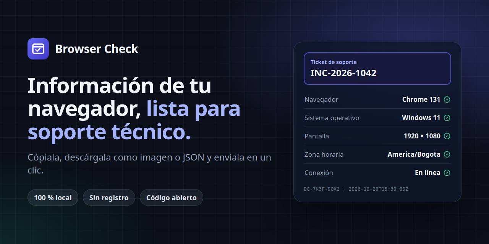

<p align="center">
  
</p>

# Browser Check

Herramienta web de código abierto para que cualquier persona, sin conocimientos técnicos, consulte la información de su navegador y dispositivo y la envíe a soporte técnico: copiando un texto, descargando una captura PNG o un archivo JSON, o compartiéndola desde el móvil.

- **100 % en el navegador.** Sin backend, base de datos, cuentas, analítica, cookies ni peticiones de red en tiempo de ejecución.
- **Campo de identificación personalizado** (ticket, nombre, referencia del caso) incluido en el texto, la captura y el JSON.
- **Honesta con los datos.** Cada valor se marca como *Detectado*, *Estimado* o *No disponible*; nada se inventa.
- Español por defecto, inglés incluido. Tema claro/oscuro con detección automática. Accesible y adaptable a cualquier pantalla.

## Inicio rápido

Requiere **Node.js 20.19+** (ver `.nvmrc`).

```bash
nvm use            # opcional
npm install
npm run dev        # http://localhost:5173
```

| Script              | Descripción                                         |
| ------------------- | --------------------------------------------------- |
| `npm run dev`       | Servidor de desarrollo con recarga en caliente      |
| `npm test`          | Pruebas unitarias y de componentes (Vitest + jsdom) |
| `npm run typecheck` | Comprobación de tipos con TypeScript                |
| `npm run build`     | Comprobación de tipos + build de producción en `dist/` |
| `npm run preview`   | Sirve `dist/` localmente                            |
| `npm run images`    | Regenera la imagen social, el banner y los iconos   |

## Despliegue

`npm run build` genera un sitio estático en `dist/` con rutas relativas (`base: './'`), así que funciona en la raíz de un dominio o en un subdirectorio.

- **GitHub Pages:** el flujo `.github/workflows/deploy.yml` ejecuta las pruebas, construye y publica en cada push a `main`. Activa *Settings → Pages → Source: GitHub Actions*.
- **Cloudflare Pages / Netlify / Vercel:** comando de build `npm run build`, directorio de salida `dist`, versión de Node 20.19 o superior.
- **Cualquier hosting estático** (Nginx, S3, etc.): sube el contenido de `dist/`.

Sirve el sitio por **HTTPS**. Por HTTP la página funciona, pero el navegador desactiva algunas APIs (portapapeles moderno, compartir nativo, Service Worker, Client Hints), y la página muestra un aviso cuando ocurre.

## SEO y vista previa en redes sociales

- `index.html` incluye título y descripción optimizados, URL canónica, Open Graph, X/Twitter Card (`summary_large_image`), datos estructurados JSON-LD (`WebApplication`), manifiesto web e iconos para Android/iOS.
- Dentro de `#root` hay contenido estático (título y descripción), así los rastreadores que no ejecutan JavaScript también lo leen.
- Las redes sociales exigen **URLs absolutas** para `og:image`. La URL pública se toma de `SITE_URL` o, si no existe, de `homepage` en `package.json` (`https://hstev.github.io/browser-check/`). En GitHub Actions se obtiene automáticamente de `actions/configure-pages`, así que también funciona con un dominio propio. En otros hostings:
  ```bash
  SITE_URL=https://check.midominio.com/ npm run build
  ```
- El build genera `robots.txt` y `sitemap.xml`. Si el sitio vive en un subdirectorio (por ejemplo, un proyecto de GitHub Pages), los buscadores solo leen el `robots.txt` de la raíz del dominio; envía el sitemap manualmente desde Google Search Console.
- **Imágenes** (generadas desde plantillas HTML en `scripts/generate-images.mjs`):
  | Archivo | Tamaño | Uso |
  | --- | --- | --- |
  | `public/og-image.png` | 1200×630 | Vista previa al compartir el enlace (Facebook, LinkedIn, WhatsApp, X, Slack…) |
  | `docs/banner.png` | 1280×640 | Banner del README y *Social preview* del repositorio en GitHub (*Settings → General*) |
  | `public/icon-192.png`, `icon-512.png`, `icon-maskable-512.png` | — | Manifiesto web / Android |
  | `public/apple-touch-icon.png` | 180×180 | Pantalla de inicio en iOS |

  Para regenerarlas: `npx playwright install chromium && npm run images`.
- Para comprobar la vista previa después de desplegar: [Facebook Sharing Debugger](https://developers.facebook.com/tools/debug/), [LinkedIn Post Inspector](https://www.linkedin.com/post-inspector/) u [opengraph.xyz](https://www.opengraph.xyz/). Algunas redes guardan la vista previa en caché; usa "Scrape again" tras cambiar la imagen.

## Configuración del campo de identificación

- **Etiqueta por defecto al compilar:** `VITE_IDENTIFIER_LABEL="Ticket de soporte" npm run build`.
- **Enlace precargado:** soporte puede enviar un enlace como
  `https://tu-sitio/#label=Ticket%20de%20soporte&value=INC-2026-1042`.
  Los parámetros van en el fragmento (`#`), que el navegador **no envía al servidor**.
- El usuario también puede renombrar la etiqueta desde la página ("Cambiar nombre del campo").
- Límite: 150 caracteres para el valor y 60 para la etiqueta. Los valores se guardan en `sessionStorage`, así que sobreviven a una recarga accidental y se borran al cerrar la pestaña. Nunca se almacenan de forma persistente.

## Qué información se recopila

| Sección | Datos |
| --- | --- |
| Navegador | Nombre y versión, motor, plataforma, idioma(s), cookies habilitadas, JavaScript, User-Agent, marcas de Client Hints |
| Dispositivo | Sistema operativo, tipo de dispositivo (estimado), resolución, pantalla disponible, ventana, densidad de píxeles, profundidad de color, orientación, táctil, núcleos, memoria, estado y calidad de conexión |
| Regional | Configuración regional, zona horaria, fecha/hora local, diferencia con UTC |
| Entorno | URL y procedencia (**sin query string ni fragmento**), origen, protocolo, contexto seguro, `localStorage`/`sessionStorage` (probados con escritura segura), Service Worker, WebRTC |
| Funciones | WebGL/WebGL 2, WebAssembly, IndexedDB, Clipboard API, Web Share, notificaciones, visor PDF, tema preferido, movimiento reducido |
| Metadatos | ID de diagnóstico local (`BC-XXXX-XXXX`), fecha ISO 8601, versión de la aplicación |

**No** se accede a cámara, micrófono, ubicación, contactos, contenido de cookies, contraseñas, tokens ni historial. No se pide ningún permiso al usuario. Las APIs que requieren permisos solo se detectan, nunca se invocan (por ejemplo, no se llama a `Notification.requestPermission`). Para comprobar WebGL se crea un contexto temporal que se libera de inmediato.

## Exportación

- **Copiar información:** texto legible con encabezados por sección. Usa `navigator.clipboard.writeText` y, si falla, `document.execCommand('copy')`. Si ambos fallan, se abre un diálogo con el texto ya seleccionado para copiarlo a mano.
- **Capturar pantalla:** genera un PNG de una **versión del reporte preparada para imprimir** (diseño horizontal de 1400 px en 3 columnas para que quepa en una pantalla sin desplazarse, a 2×–3× de resolución, con todas las secciones, incluidas las avanzadas, y sin botones), con el nombre de la app, el ID y la fecha. Usa [`html-to-image`](https://github.com/bubkoo/html-to-image). No captura la pantalla del sistema ni la interfaz del navegador.
- **Copiar captura:** se muestra solo si existe `ClipboardItem`; si la escritura falla, la imagen se descarga.
- **Descargar JSON:** valores sin traducir con su estado, por ejemplo `browser-check-INC-2026-1042.json`. Al nombre del archivo se le quitan los acentos y los caracteres no válidos.
- **Compartir:** se muestra solo si existe `navigator.share`. Comparte el reporte en texto.

## Limitaciones de los navegadores

Estas son limitaciones de la plataforma web que un sitio estático no puede resolver:

- **El User-Agent no es fiable.** Chrome, Edge y Safari lo "congelan": Windows 11 se reporta como Windows 10 y macOS siempre como 10.15.7. Por eso la app muestra "Windows 10 / 11" y omite la versión de macOS, salvo que haya Client Hints.
- **User-Agent Client Hints** (versión exacta, Windows 10 vs 11) solo existen en navegadores Chromium y en HTTPS. En Linux, la "versión" que reporta Chrome es la del kernel.
- **Firefox y Safari** no exponen memoria del dispositivo ni calidad de conexión. Chromium redondea la memoria a un máximo de 8 GB.
- **iPadOS** se presenta como un Mac. Se deduce que es un iPad por la pantalla táctil, y se marca como estimado.
- **Brave, Firefox (resistFingerprinting) y Safari** pueden redondear o falsear la resolución, la zona horaria, los núcleos o el idioma.
- El **tipo de dispositivo** siempre es una estimación.
- **Navegación privada / cookies bloqueadas:** `localStorage` o `sessionStorage` pueden estar presentes pero fallar. Se prueban de forma segura y se muestran como "No".
- **Referrer:** suele estar vacío por las políticas de privacidad del navegador.
- **Portapapeles:** requiere HTTPS y un gesto del usuario. En navegadores sin `ClipboardItem` (o si se deniega el permiso), la imagen se descarga en su lugar.
- **Capturas en Safari/iOS:** el lienzo tiene un límite de ~16,7 MP; la densidad de la imagen se reduce automáticamente en reportes muy largos. WebKit necesita una pasada de "calentamiento" que hace la captura algo más lenta.
- **Descargas en iOS:** Safari puede abrir el archivo en una vista previa en lugar de guardarlo directamente.
- **Compartir** está disponible sobre todo en móviles, Safari y Edge/Chrome en Windows. En Firefox de escritorio no aparece.
- Si **JavaScript está desactivado**, solo se muestra un mensaje explicativo (`<noscript>`).

## Arquitectura

```
src/
  lib/diagnostics/   collect.ts (recopilación con detección de funciones), userAgent.ts (análisis best-effort), types.ts
  lib/               report.ts (texto), export.ts (JSON + nombres de archivo), clipboard.ts, screenshot.ts, share.ts, download.ts, storage.ts, id.ts
  i18n/              es.ts (diccionario base y tipo), en.ts, index.tsx (contexto)
  hooks/             useDiagnostics, useCustomIdentifier, useTheme
  components/        Header, IdentifierCard, ActionBar, Summary, SectionCard, FieldList, AdvancedDetails, ReportSheet, Notices, Toast, ManualCopyDialog
```

- Cada acceso a una API está envuelto en `try/catch`. La ausencia de una API produce `No disponible`, nunca un error.
- `collectDiagnostics(window)` acepta un objeto `window` inyectable, lo que facilita las pruebas con entornos simulados.

### Añadir un idioma

1. Copia `src/i18n/en.ts` a `src/i18n/<código>.ts` y tradúcelo (el tipo `Dictionary` obliga a incluir todas las claves).
2. Regístralo en `dictionaries`, en `src/i18n/index.tsx`.

### Añadir un campo de diagnóstico

1. Añade el identificador a `FieldId` en `types.ts`.
2. Recógelo en la sección correspondiente de `collect.ts` con `field(id, value, status)`.
3. Añade la etiqueta en cada diccionario (`fields`). TypeScript avisará si falta alguna.

## Contribuir

1. Haz un fork y crea una rama.
2. `npm install && npm test && npm run build`.
3. Mantén el principio de privacidad: nada de peticiones de red, analítica ni permisos innecesarios.
4. Añade pruebas para los cambios en la recopilación o en la exportación.
5. Abre un Pull Request describiendo el cambio y en qué navegadores lo probaste.

## Licencia

[MIT](./LICENSE)
